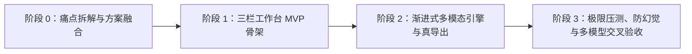
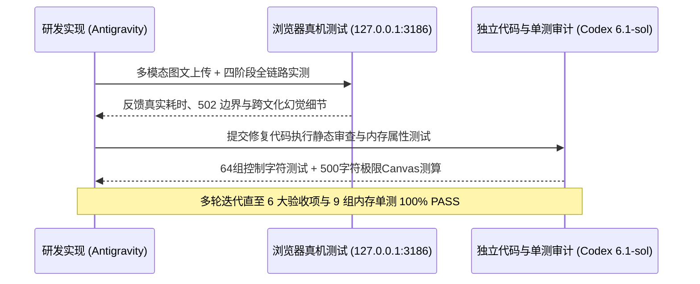

# GlobalVibe 研发演进与工程复盘记录（Development Log）

> **赛题方向**：知乎黑客松 2026 · 命题 3｜出海新航路 — 跨境市场营销物料 AI 工具  
> **核心主张**：*Good products travel well. Don't just translate your product. Translate why it matters.*（不止于中译英，把中国好产品的卖点重构为海外听得懂的价值。）

---

## 一、产品演进脉络总览

| 阶段 | 里程碑目标 | 关键突破与工程产出 |
|---|---|---|
| **阶段 0：创意立项** | 跳出“套壳翻译器”同质化陷阱 | 将「去中式卖点重构」、「跨文化避雷针」、「多端语态裂变 + DTC 视觉海报」、「海外虚拟客群毒舌测款」四大模块串联为单页三栏流水线 |
| **阶段 1：MVP 骨架**（Commit `47aa4b8`） | 跑通单页三栏交互与基础数据契约 | 基于 Next.js 16 + React 19 + Tailwind CSS v4 搭建「商品简报 → 创意工作区 → 跨文化洞察」三栏架构；接入本地 OPUS 直译对照与单案例演示流 |
| **阶段 2：全链路真 AI 化**（Commit `452fabd`） | 解决 60s 接口超时、补齐多模态与真物料导出 | 拆分四阶段渐进式 API + Flash 模型低延迟调优（单阶段提速 **5.3 倍**）；默认中文界面与「海外成稿英文 / 运营洞察中文」分治；零生图成本 Canvas 高清 PNG 海报导出；3 品类高反差案例与三层纯享复制；Vercel 无服务器与限流适配 |
| **阶段 3：压测加固与终审** | 消除幻觉、极端输入崩溃与排版越界隐患 | 通过“图文错配 + 中东高危禁忌”压力测试，建立三阶段共享防幻觉铁律（`SHARED_INTEGRITY_RULES`）、高危原图自动拦截、JSON 状态机清洗与双语强契约校验；通过浏览器真机 + Codex 多轮单元测试 **6/6 全项 PASS** |

---

## 二、分阶段详细研发与修改记录

### 阶段 0：赛题拆解与差异化架构设计
1. **核心痛点洞察**：国内跨境卖家常用的“全网销冠、黑科技、7天急速美白、军工防爆、亏本买一送五”等话术，若直接字面翻译成英文，在欧美及中东市场极易触发 **FTC/FDA 广告合规封号**、**肤色/宗教文化冲突（如 `Whitening` / `Wine`）** 或 **廉价诈骗感（Dropshipping Scam Vibe）**。
2. **工作流融合决策**：放弃割裂的多页面菜单，设计为一屏三栏闭环工作台：
   * **左栏（输入与配置）**：支持中文卖点原稿 + 国内电商海报多模态上传 + 目标市场/受众/五类分发渠道选择。
   * **中栏（创作与导出）**：字面直译 vs 本土化重构并排对照 + 五大平台（TikTok / Instagram / Reddit / Website / B2B Email）原生语态物料 + 极简 DTC 视觉海报合成。
   * **右栏（诊断与验证）**：5 维跨文化红黄绿风险雷达 + 3 位海外本土虚拟消费者模拟锐评 + 一键迭代生成精修版本 2（带删除线前后差异对比）。

---

### 阶段 1：MVP 工作台与双层架构初始化（Commit `47aa4b8`）
* **工程基础**：采用 `Next.js 16 (App Router)` + `React 19` + `TypeScript 5.9` + `Tailwind CSS v4` + `Zod v4` 强类型校验。
* **领域模型抽象**（`src/domain/types.ts`、`src/domain/services.ts`）：定义清晰的 `ProductInput`、`SellingPoint`、`CulturalRisk`、`PlatformAsset`、`ConsumerFeedback` 与可辨识联合状态机 `WorkflowState`（`empty → ready → analyzing → generated → testing → feedback-ready → refined`）。
* **初版局限性复盘（实测暴露的问题）**：
  1. **60 秒网关超时**：`/api/campaign` 在单次同步请求中要求大模型一次性输出卖点重构与全部 5 个渠道长文案，叠加推理模型思考开销，频繁卡死 55~60 秒触发 `504 Gateway Timeout`。
  2. **部分环节静态化**：跨文化风险诊断与右栏虚拟焦点小组仅使用前端静态模拟数据，未接入真实大模型。
  3. **运营提示语种错位**：切换中文界面后，调整依据与跨文化诊断说明仍为纯英文，不利于国内跨境运营快速理解改写逻辑。
  4. **导出能力未激活**：「导出物料」按钮处于禁用占位状态，且修改左侧任一参数会静默清空右侧已生成成果。

---

### 阶段 2：渐进式多模态引擎重构与生产力闭环升级（Commit `452fabd`）

#### 1. 根治 60s 超时：四阶段拆分 + 模型自适应极速推理（`src/app/api/campaign/route.ts`）
* **分步渐进式请求**：将原单一大请求拆解为 4 个独立轻量阶段：
  1. `stage: "diagnose"`：接收文本与前端 Canvas 预压缩（`<= 960px` JPEG）的商品图 DataURL，先行返回商品画像、5 维跨文化风险与卖点重构表并**立即渲染上屏**（新增 `creating` 中间态，首屏反馈时间大幅缩短）；
  2. `stage: "channels"`：**仅针对用户当前勾选的渠道**生成原生英文物料及每渠道专属的 2 条跨文化传播提示；
  3. `stage: "focus-group"`：实时生成 3 位契合目标市场与受众画像的本土虚拟消费者毒舌点评；
  4. `stage: "refine"`：根据 3 位虚拟消费者的具体顾虑生成版本 2 精修卖点、渠道文案与修改要点摘要。
* **推理耗时优化实测对比**：针对不同模型家族自动匹配最优低延迟参数（如为 `qwen3.8-flash` 自动注入 `enable_thinking: false` 与 `response_format: { type: "json_object" }`），在真实案例实测中，`channels` 阶段耗时从 `42.33s` 降至 **`7.90s`（提速 5.3 倍）**，全套 4 阶段均稳定 `200 OK`。
* **双模切换与应急兜底**：顶栏右侧提供 `GetRun AI 实时模式` 与 `模拟演示模式（秒出）` 一键切换，实时等待期间支持点击「跳过等待，立即展示预置方案」。

#### 2. 默认中文系统与「中英分治」双语无损互切
* 默认以简体中文（`zh-Hans`）启动界面，重置操作保留当前语言偏好。
* **双语结构化输出**：海外投放成稿（卖点英文、各渠道正文/标题/CTA/Hashtags）严格保持地道英文；面向国内运营的**调整依据、五维风险解析、各渠道跨文化传播提示、虚拟消费者参考译文与槽点、V2 优化要点**同时生成中英双语字段，生成后点击右上角 `EN / 中文` 无需重跑接口即可无损切换。

#### 3. 三品类高反差内置案例库（`src/domain/mock-data.ts` + `public/`）
内置 3 套覆盖核心出海痛点的预置案例及对比测试图：
1. **3C 数码 · 便携快充充电宝**：聚焦 `99.9Wh (<100Wh)` TSA 随身登机合规表达、剔除引起恐慌的“军工防爆/绝不自燃”及竞品商标拉踩。
2. **美妆护肤 · RF 射频光疗美容仪**：聚焦拦截欧美大忌 `Whitening（美白）` 重构为 `Radiant Glow`、剔除违反 FTC/FDA 的“7天逆龄10岁/100%击退黑色素”，并内置**双11红金雷电原图 vs 暖石极简 DTC 场景底图**一键对比。
3. **户外数码 · 便携电动意式咖啡机**：聚焦工业参数转北美自驾露营（Overlanding / 禁火季无明火萃取）场景、公英制换算（`92°C → 198°F`、`80ml → 2.7 fl. oz.`、`620g → 1.37 lbs`）及 `Reddit` 严格反硬广透明社区帖写法。

#### 4. 零生图额度消耗的本地海报合成与多级复制体验（`src/lib/export-assets.ts`、`src/components/creative-workspace.tsx`）
* **高分 PNG 海报合成**：为 `Instagram`（1080×1350）和 `Website`（1440×760）提供 **深邃靛蓝 / 暖石米白 / 森系黑曜** 3 套极简主题切换，基于浏览器本地 Canvas 2D 引擎毫秒级合成导出高清 `.png` 海报，商品外观不变形、英文零错字且 **0 API 生图成本**。
* **结构化 `.md` 物料包导出**：全渠道支持一键导出包含渠道成稿、传播提示、卖点对照表、跨文化风险与客群反馈的 Markdown 文档。
* **三层纯享复制交互**：新增每个细分字段（如 Hook、正文、Hashtags、邮件标题）右上角的**「单独复制」**（仅复制纯英文正文，不含标题字样，可直接粘贴发帖）、单条卖点复制及**「复制全部英文卖点」**（自动生成项目符号列表适配独立站/Amazon 五点描述）。
* **结果快照锁定与防误清空**：编辑左栏参数不再清空已生成结果，导出与后续测试严格绑定生成时刻的 `config` 与 `image` 快照。

#### 5. 公网 Serverless 部署加固（`next.config.ts`、`src/app/api/translate/route.ts`）
* 识别 `process.env.VERCEL` 自动将本地模型缓存目录切换至可写的 `/tmp/.model-cache`，并在打包追踪中排除本地 `.model-cache` 大文件。
* 在 `/api/campaign` 增加严格同源校验（兼容 `127.0.0.1`、`localhost` 与反向代理头）及公网单 IP 滑动窗口防刷限流（每小时 25 次）。

---

### 阶段 3：极限压力测试、防幻觉加固与多智能体交叉验收

为检验系统在极端边缘输入下的鲁棒性，团队设计了**「故意上传错配的双11美容仪海报 + 含酒精/红酒杯造型/性感女郎插画的中东家庭香薰文案」**高压测试，并引入多轮自动化代码与内存单元测试审查，完成以下关键打磨：

1. **三阶段共享防幻觉与跨文化铁律（`SHARED_INTEGRITY_RULES`）**：
   * **杜绝“反向合规幻觉”**：严禁模型因目标市场忌讳某成分而凭空捏造虚假属性（例如原品明确为“酒精基底”时，严禁在英文成稿中伪造 `"Alcohol-Free"`，亦严禁虚构 `UL/FDA/CE` 认证或防摔防水属性，避免法律纠纷）。
   * **中东器皿与文化禁词闭环**：在中东市场彻底禁用 `wine / wine-glass / champagne / cocktail` 等酒类隐喻（即使仅描述杯型，也统一重构为 `stemmed glass silhouette / sculpted goblet`）。
   * **渠道格式净化**：确保 `B2B Email` 始终保持面向海外零售买手的外部开发信口吻；在服务端自动剥离混入 `Instagram` 正文的 `#标签`（完整覆盖 Unicode 组合音标 `\p{M}`、多语种字符及标点紧邻标签，并拒绝纯标签空正文）。
2. **高危/图文不符原图自动拦截机制**：
   * 当多模态诊断检出 `Visual Adaptation` 为 **高危（High）**（如上传图片与文字商品货不对板，或存在重度促销牛皮癣特效）时，海报卡片默认自动屏蔽高危原图并给出提示（保留手动对比开关），同时在无有效商品图时自动禁用 PNG 导出按钮，杜绝导出空白框残次海报。
3. **复合长句与四字短卖点智能切分（`splitSourcePoints`）**：
   * 支持中文逗号及非数字英文逗号智能切分（完整保护 `20,000mAh` 等千分位数字不被误拆），保留“快速充电”、“双口输出”等四字短卖点独立成行，超 5 项时均衡归组保留尾部规格参数。
4. **JSON 状态机清洗与严格双语 Schema 校验**：
   * 手写字符级 JSON 清洗状态机 `sanitizeJsonString`，安全转义字符串内全部 `U+0000–U+001F` 控制字符（含反斜杠紧接裸换行边界），且仅在字符串外部剥离尾随逗号，不篡改合法正文。
   * 使用 `enText` / `zhText` 正则约束强制校验中英文字段语种归属、5 个不重复风险维度完整性及双语提示条数对齐。
   * 强化 V1 防降级保护：实时生成的 V1 在任何异常或模式切换下均不会被通用 Mock 模板覆盖，且支持基于 V2 持续重跑客群测试与迭代精修。
5. **Canvas 海报全元素横纵双向像素防越界**：
   * 新增 `splitOversizedTokens` 与 `clampTokenToWidth` 像素级测量截断算法，对超长连续无空格单词、多行卖点及底部 CTA 按钮（含 `fillText` 最大宽度约束）实施严格横纵边界保护，确保任意极端文案在 1080×1350 与 1440×760 画布中均零溢出、零裁切。

### 阶段四：知乎开放平台深度融合 —— 社区出海实战引证与知乎直答联动
针对黑客松赛事“深度结合知乎社区生态与开放能力”的核心要求，把 AI 跨文化诊断升级为 **「AI 预审 + 知乎一线跨境答主实战案例背书」**：
1. **服务端直连知乎开放平台双接口（`src/app/api/zhihu/route.ts`）**：
   * 采用标准服务端 REST 协议（`Bearer` 鉴权 + 秒级 `X-Request-Timestamp` 时间戳），无本地 CLI 二进制依赖，100% 兼容知乎 AI Works 与云端 Serverless 部署，且密钥严格隔离在服务端。
   * **知乎站内搜索（`zhihu_search`）自动引证**：根据商品品类、目标市场（美/英/欧/中东）及勾选渠道（如 Reddit / TikTok / B2B Email）动态生成 3 组高命中率跨境检索词，拉取知乎真实问答与专栏摘要，清洗 HTML 高亮标签、校验 `zhihu.com` 安全域名，并完整保留官方 `utm_medium=openapi_platform` 溯源外链。
   * **知乎直答（`zhida-fast-1p5`）按需提炼**：提供一键调用按钮，结合当前产品命中的高/中危跨文化风险，实时输出 3 条精炼可执行的跨境避坑对策（支持中英双语切换刷新）。
2. **非阻塞并发加载与优雅降级**：
   * 在 Stage 1 诊断就绪及预置案例切换时独立后台并发请求，零阻塞中间栏多渠道文案生成；内置 15 分钟进程级缓存避免重复消耗日额度，并在未配密钥、超时或额度受限（`30001`）时如实展示状态徽章与精选参考卡片。

---

## 三、质量保障与验证体系

项目采用 **「浏览器端到端真机实测 + 独立 AI 审查模型（Codex `gpt-6.2-astra` & `gpt-6.1-sol`）多轮单元测试」** 双重验收机制：

* **静态检查**：`npm run typecheck`（TypeScript 严格模式）与 `npm run lint`（ESLint 9 + Next 16 React Hooks 规则）全程 `exit 0` 零错误、零警告。
* **真机端到端验证**：覆盖默认中文启动、3 套预置案例秒切、多模态图片上传识图、美/欧/中东多市场四阶段 `HTTP 200 OK` 实时生成、PNG 海报与 `.md` 物料真实下载。
* **极限单元测试验证**：通过 64 组 JSON 控制字符/转义组合测试、多语种 Unicode 标签剥离测试、短句/千分位卖点切分测试及双版式三主题 500 字符极限 Canvas 像素边界测试，**终轮 6/6 验收维度全部 PASS**。
